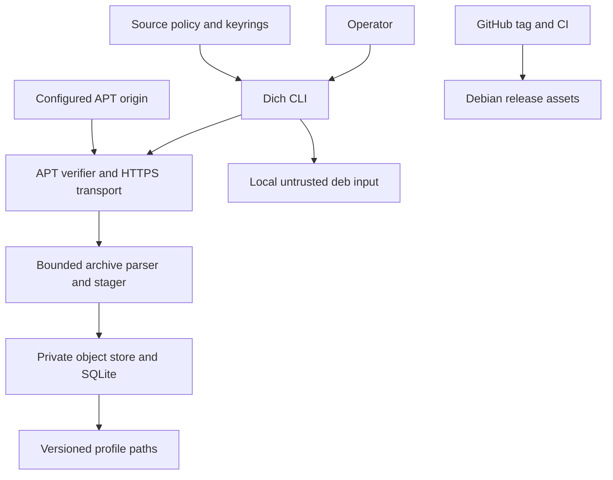

# Dich Project Threat Model

Assessment date: 2026-11-04. Scope: current local worktree based on `master` commit `2c26af4` plus documentation corrections in this review. This is an internal, repository-grounded review, not an independent penetration test or release approval.

## Executive summary

Dich is a local Rust CLI with no inbound listener. Its main security boundary is from operator-configured signing keys through HTTPS APT metadata to verified package bytes and into a private store/profile. Signature, digest, path and resource controls substantially reduce malicious mirror and archive risks. The highest residual risks are compromise of a trusted repository signing key, loading a selected DSO with caller privileges, same-user tampering or deletion of rollback state, and release-tag permissions that can publish a build. `dlmopen` isolates symbol lookup only; it is not a process sandbox. The project remains experimental. The first `v0.7.0` release attempt failed before job setup due to an invalid action pin; the corrected pin is covered by green master CI, but the release workflow must still be rerun.

## Scope and assumptions

- In scope: `crates/dich-cli`, `crates/dich-apt`, `crates/dich-deb`, `crates/dich-elf`, `crates/dich-store`, `crates/dich-engine`, the GitHub workflows, and security/release documentation.
- Runtime: a Linux CLI on supported Debian/Ubuntu amd64 hosts; rootless use is preferred. `--system` uses system state directories but is not a daemon or privilege broker.
- Assumption pending operator confirmation: one trusted operator owns the store on a private or CI host. If multiple mutually untrusted users share a host, same-UID and root-owned store risks must be reassessed.
- Assumption: outbound HTTPS is limited to explicitly configured APT origins; no inbound network service exists.
- Assumption: the store contains package data, repository metadata, profiles and software inventory; no application secrets or personal data are intentionally stored.
- Trust anchors, system clock, local filesystem owner, installed helper binaries, Rust/Cargo supply chain, GitHub repository permissions and maintainers are trusted.
- Out of scope: host APT/dpkg installation, arbitrary package relocation, maintainer-script execution, service management, kernel isolation, `dlmopen` sandboxing and compromise after the operator loads an untrusted DSO.
- Open question: confirm single-operator/private-host use versus a shared multi-user host. This changes local filesystem threat likelihood and severity.

## System model

### Primary components

- `dich-cli` parses command-line arguments and dispatches operations (`crates/dich-cli/src/main.rs`, `crates/dich-cli/src/lib.rs`).
- `dich-apt` loads trusted source policy, verifies `InRelease` or `Release.gpg`, validates Release freshness and digests, fetches indexes/artifacts over HTTPS, and protects cache state (`crates/dich-apt/src/signatures.rs`, `transport.rs`, `cache.rs`, `artifact.rs`). Signature checking invokes fixed `/usr/bin/gpgv` through `/usr/bin/prlimit`.
- `dich-deb` parses bounded untrusted archives and privately stages verified artifacts (`crates/dich-deb/src/lib.rs`, `staging.rs`). Maintainer scripts are metadata only.
- `dich-elf` and `dich-engine` produce conservative evidence and gate the narrow DSO profile path. Profile selection does not execute package code (`crates/dich-elf/src`, `crates/dich-engine/src/lib.rs`).
- `dich-store` stores verified objects and manages SQLite metadata, profiles, recovery and GC (`crates/dich-store/src`).
- CI runs checks and four-image package smoke tests. A `v*` tag triggers package build, SBOM, checksum, provenance attestation and prerelease publication (`.github/workflows/ci.yml`, `.github/workflows/release.yml`).

### Data flows and trust boundaries

- Operator → CLI: arguments, paths and explicit proxy/freshness options over `execve`; Clap parsing and typed policy validation apply. Environment is limited to documented XDG/HOME and log settings (`crates/dich-cli/src/lib.rs`, `paths.rs`).
- Operator files → source policy/keyring loader: TOML/deb822, URIs, fingerprints and public keyring files over local filesystem reads; unknown fields, unsafe ownership/permissions and symlinks are rejected (`crates/dich-apt/src`, `crates/dich-cli/src/paths.rs`). Local filesystem owner remains trusted.
- Configured APT origin → transport: Release/index/archive bytes over HTTPS with certificate validation, source-bound redirect policy, explicit size bounds, signed digest checks and freshness/rollback checks (`crates/dich-apt/src/transport.rs`, `artifact.rs`). A malicious signer can still authenticate malicious content.
- Verified archive → parser/stager/store: hostile tar/control/ELF bytes cross bounded parsers and descriptor-relative private staging; paths/links/special files and dangerous modes are rejected; scripts never execute (`crates/dich-deb/src/lib.rs`, `staging.rs`, `crates/dich-store/src/publication.rs`).
- Store → profile/GC: local SQLite metadata and profile generations cross transactional operations protected by ownership/mode checks, locks, atomic rename and recovery logic (`crates/dich-store/src/metadata.rs`, `profiles.rs`, `gc.rs`). This protects against races and untrusted paths, not a malicious owner of the same UID.
- Maintainer/tag writer → GitHub Actions → release consumers: source and tag trigger privileged build/publish workflow; pinned actions/tool versions and CI gates constrain the flow. Workflow permissions include `contents: write`, `id-token: write`, and `attestations: write` at workflow scope (`.github/workflows/release.yml`). Provenance attests build origin; it does not establish source safety or tag authorization.

### Diagram

## Assets and security objectives

| Asset | Why it matters | Security objective (C/I/A) |
|---|---|---|
| Trusted source policy and keyring files | Define which publishers may authorize package bytes | C low, I high, A medium |
| Signed Release/index cache and rollback floor | Prevent forged metadata and stale package selection | C low, I high, A medium |
| Downloaded archives, extracted trees and profile graph | May later be loaded by a caller and determine active version | C low, I high, A high |
| SQLite metadata and profile pointers | Corruption can select wrong objects or lose recovery/GC state | C low, I high, A high |
| Host package database and system directories | Must remain outside store operations | I high, A high |
| Release `.deb`, SBOM, checksum and provenance | Distribution consumers rely on artifact identity and source | I high, A medium |
| GitHub token/OIDC permissions and signing keys | Can authorize public artifacts or repository trust | C high, I high, A medium |

## Attacker model

### Capabilities

- Control a mirror, network route or HTTP response; submit malformed Release/index/archive/ELF data; trigger bounded resource use.
- Control a trusted repository signing key or exploit its maintainer process, thereby producing correctly signed malicious package metadata/artifacts.
- Run as the same unprivileged user and race or edit files that user owns, delete the cache/rollback floor, or replace local profile data outside Dich's APIs.
- Obtain repository tag/write permission or compromise a release dependency/action to influence published artifacts.

### Non-capabilities

- No unauthenticated inbound service is present.
- A network attacker alone cannot forge a configured OpenPGP signature or valid TLS certificate.
- Package maintainer scripts are not run by Dich; install does not invoke host apt/dpkg and does not execute binaries.
- Cross-user or root compromise is not assumed unless Dich runs with elevated privileges or a shared-host deployment is confirmed.

## Entry points and attack surfaces

| Surface | How reached | Trust boundary | Notes | Evidence |
|---|---|---|---|---|
| CLI arguments | Local process invocation | User → parser/orchestrator | Paths, exact versions, profile names, URLs/options | `crates/dich-cli/src/lib.rs`, `main.rs` |
| Source config/keyring | `--config` or default config paths | Operator files → trust policy | Symlinks, ownership, mode, malformed fields | `crates/dich-apt/src/source.rs`, `keyring.rs`; `crates/dich-cli/src/paths.rs` |
| APT metadata and artifacts | `update`, `fetch`, `install` | Configured origin → verifier | TLS, signed metadata, bounded downloads and digest chain | `crates/dich-apt/src/transport.rs`, `artifact.rs` |
| Local `.deb` inspection | `dich inspect FILE` | Caller file → archive/ELF parser | Not authenticated; result is not install authorization | `crates/dich-deb/src/lib.rs`, `crates/dich-cli/tests/inspect_cli.rs` |
| Cache, store, SQLite, profiles and GC | CLI operations | Same host/filesystem → durable state | Concurrent operations, crash recovery, path races, disk pressure | `crates/dich-store/src`, `crates/dich-apt/src/cache.rs` |
| Release workflow | Push `v*` tag | GitHub repository permissions → public assets | Write/OIDC/attestation permissions and pinned dependencies | `.github/workflows/release.yml` |

## Top abuse paths

1. Stolen repository signing key → publish signed malicious DSO → metadata and artifact checks succeed → operator selects profile → downstream application loads a DSO function/constructor with its own privileges.
2. Hostile mirror/network → replay or redirect metadata/artifacts → attempt downgrade or origin escape → cache freshness, digest, redirect and rollback checks reject; deleting the complete local floor can weaken rollback detection.
3. Same-UID process → race/delete store/cache/profile files outside Dich → corrupt local state or reset rollback floor → impact is limited to that user's store unless elevated/shared deployment is used.
4. Malformed `.deb`/ELF → parser/decompressor consumes CPU, memory or disk → deny service to the local operator; byte, file, CPU and disk limits reduce but do not eliminate availability risk.
5. Tag writer or compromised release dependency → push `v*` tag or alter build inputs → workflow uses write/OIDC permissions to publish a prerelease → consumers receive an artifact whose provenance is valid but whose source may be malicious.

## Threat model table

| Threat ID | Threat source | Prerequisites | Threat action | Impact | Impacted assets | Existing controls (evidence) | Gaps | Recommended mitigations | Detection ideas | Likelihood | Impact severity | Priority |
|---|---|---|---|---|---|---|---|---|---|---|---|---|
| TM-001 | Repository signing-key compromise | Attacker steals/abuses a configured signing key or compromises its publisher. | Sign malicious metadata and a DSO that passes static compatibility checks. | Verified package content may later run when explicitly loaded by a consumer. | Keyring trust, package trees, consumer process | Fingerprint allowlist, digest chain, fresh metadata, conservative DSO gate (`crates/dich-apt/src/signatures.rs`, `crates/dich-engine/src/lib.rs`). | Cryptographic authenticity cannot distinguish a malicious authorized publisher; DSO loading runs with caller privileges and is not sandboxed. | Use minimal repository key scope, monitor key rotations, document revocation/recovery, and require an independent publisher review for release-grade DSO sources. | Alert on signer fingerprint changes, package digest changes and unexpected version transitions. | Medium: key compromise is uncommon but realistic for repositories. | High: downstream code may execute with caller rights. | high |
| TM-002 | GitHub tag/release permission compromise | Attacker has tag/write access or compromises a pinned/reachable build dependency. | Trigger `v*` release and use workflow write/OIDC permissions to publish package and attestations. | Malicious or unauthorized public release; provenance may faithfully attest the compromised source. | Release assets, consumer trust, GitHub permissions | Pinned actions/tool versions, CI gates, distro smoke matrix, SBOM and build provenance (`.github/workflows/release.yml`). | No visible signed-tag verification, protected-tag rule or reviewer-gated release environment; permissions are workflow-scoped. | Protect `v*` tags, require signed annotated tags and independent release approval, scope write/OIDC permissions to a publish job, and verify tag commit is on the protected release branch. | Audit tag creation, workflow actor/ref, artifact digest and provenance subject; alert on unexpected release creation. | Low to medium: requires repository write or supply-chain compromise. | High: public binary distribution is compromised. | high |
| TM-003 | Same-UID local process or owner error | Attacker runs as the store owner or operator deletes/modifies owned state. | Race profile/cache files or remove the full rollback floor, then reuse stale but still-fresh metadata. | User-level store integrity or downgrade guarantees can be lost; no cross-user isolation is implied. | Cache, rollback floor, store DB, profiles | Protected modes, flock, `openat2`, no-follow traversal, atomic publication/recovery (`crates/dich-store/src`, `crates/dich-apt/src/cache.rs`). | Same-UID attacker can change owned files outside API; deleting all floor state defeats persisted rollback history. | Clearly define the trusted-owner boundary; keep system-mode state root-owned; consider external monotonic state only if rollback across full cache deletion is a required guarantee. | Check ownership/mode on startup; log state reinitialization and unexpected rollback-floor reset. | Medium on shared/dev hosts; lower on dedicated private host. | Medium: primarily affects that store's integrity and availability. | medium |
| TM-004 | Malicious or malformed archive/index | Attacker supplies large or adversarial signed/unsigned parser inputs. | Exploit parser edge cases or consume bounded CPU/memory/disk. | Local denial of service; a parser bug could corrupt or escape private staging. | Host availability, store objects, profile integrity | Bounds, `prlimit`, disk preflight, strict path/type/mode rejection, negative fixtures (`crates/dich-deb/src/lib.rs`, `staging.rs`, `crates/dich-cli/tests/security_audit_and_toctou.rs`). | Limits are finite, parser attack surface remains large, and power-loss behavior/container hardening are not fully proven. | Continue fuzzing parser boundaries and failure injection; enforce per-operation memory/time limits and preserve hostile corpus regressions. | Record bounded failure codes/resource-limit events; monitor repeated malformed package attempts. | Medium: hostile repositories and archives are realistic. | Medium to high: DoS likely; escape impact would be high. | medium |
| TM-005 | Compatibility false positive / unsafe consumer loading | A DSO passes static heuristics but has malicious or unexpected runtime behavior. | Consumer loads explicit profile path; DSO constructor/function uses caller privileges, syscalls or filesystem. | Caller process compromise; possible access to its data. | Consumer data and runtime integrity | Strict DSO class checks, no scripts/services, explicit paths; `dlmopen` fixture only demonstrates symbol namespace separation (`crates/dich-engine`, `docs/security.md`). | Static analysis is incomplete; symbol isolation is not syscall, filesystem or privilege isolation. | Keep “supported” limited and evidence-based; require consumers to treat publishers as trusted and use OS sandboxing for loaded code. | Consumer-side audit of loaded paths and process sandbox alerts. | Medium if users load artifacts from less-trusted publishers. | High for the consuming process. | high |

## Criticality calibration

- **Critical**: unauthenticated remote code execution or cross-user/root compromise from the default CLI path. No such path is established by this review.
- **High**: trusted signing/tag authority compromise that distributes malicious artifacts; malicious DSO execution in a consuming process.
- **Medium**: same-UID rollback/store integrity loss, sustained local resource exhaustion, or a parser defect confined to private state.
- **Low**: misleading metadata display or non-sensitive CLI diagnostics without influence on authorization or store state.

Assumption that most affects these ratings: single trusted store owner. A shared host with mutually untrusted users raises local filesystem issues and requires separate validation of rootless/system state ownership and resource isolation.

## Focus paths for security review

| Path | Why it matters | Related Threat IDs |
|---|---|---|
| `crates/dich-apt/src/signatures.rs` and `keyring.rs` | Signature subprocess, fingerprint policy and trust-anchor file handling. | TM-001 |
| `crates/dich-apt/src/transport.rs`, `artifact.rs`, `cache.rs` | HTTPS redirect scope, hash chain, freshness and persisted rollback state. | TM-001, TM-003 |
| `crates/dich-deb/src/lib.rs`, `staging.rs` | Hostile archive parsing, resource bounds and path containment. | TM-004 |
| `crates/dich-elf/src`, `crates/dich-engine/src/lib.rs` | Static compatibility decisions gate profile selection but cannot prove runtime safety. | TM-001, TM-005 |
| `crates/dich-store/src/publication.rs`, `profiles.rs`, `gc.rs`, `recovery.rs` | Durable publication, active profile identity, recovery and deletion invariants. | TM-003, TM-004 |
| `.github/workflows/release.yml` | Tag-triggered build, artifact publication, token/OIDC scope and provenance. | TM-002 |
| `SECURITY.md`, GitHub repository Security settings | Private vulnerability reporting is enabled; no separate maintainer security email is configured. | TM-001, TM-002 |

## Notes on use

- Review covers repository evidence and configured controls; it does not prove absence of vulnerabilities, successful behavior under physical power loss, or independent human audit.
- The `0.7.0` package has passed master CI; the release workflow has only had an initial setup failure and no GitHub Release assets are published in this assessment.
- External beta results and triage evidence are absent. Private vulnerability reporting was enabled on GitHub on 2026-11-04 (REST API response 204); no separate maintainer email is configured. Do not mark the combined beta roadmap item complete based on this internal review.
- No response to the shared-host context question was received before this draft; single-operator use remains an explicit assumption.

## Quality check

- [x] CLI, file/config, network, archive, local state and CI/release entry points covered.
- [x] Every trust boundary appears in at least one abuse path or threat row.
- [x] Runtime behavior is separated from CI/build/release behavior.
- [x] User context response not received; assumptions and open question are explicit.
- [x] Residual risks and conditional recommendations are identified.
